<!-- Generated by Tools/Workshop/make_repo_wiki.py (in the mod's repo) from the Workshop page and the mod's defs. -->

# Rim All-Stars

Let your colonists borrow the power of heroes from other worlds, across anime and games. Adds 15 heroes, each with a unique moveset, plus 25 pieces of equipment, each with a unique mechanic.

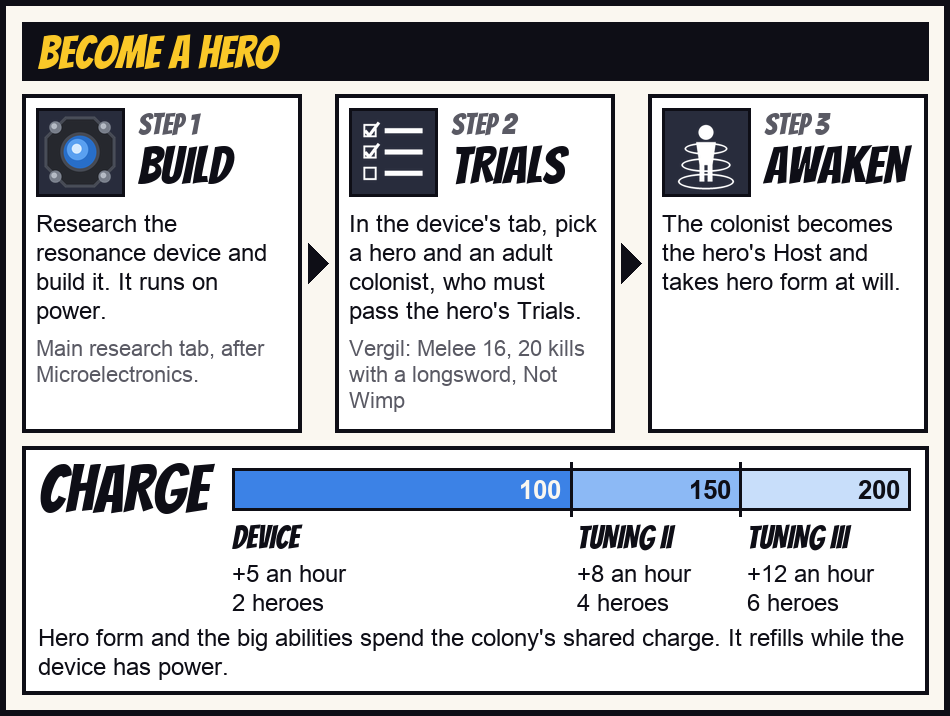

## Contents

- [Heroes](#heroes)
  - [Gojo (Jujutsu Kaisen)](#gojo-jujutsu-kaisen)
  - [Minato (Naruto)](#minato-naruto)
  - [Nakime (Demon Slayer)](#nakime-demon-slayer)
  - [Pain (Naruto)](#pain-naruto)
  - [Shirou (Fate/stay night)](#shirou-fatestay-night)
  - [Vergil (Devil May Cry)](#vergil-devil-may-cry)
  - [Accelerator (A Certain Magical Index)](#accelerator-a-certain-magical-index)
  - [Goku (Dragon Ball)](#goku-dragon-ball)
  - [Itachi (Naruto)](#itachi-naruto)
  - [Sasuke (Naruto)](#sasuke-naruto)
  - [Todo (Jujutsu Kaisen)](#todo-jujutsu-kaisen)
  - [Inumaki (Jujutsu Kaisen)](#inumaki-jujutsu-kaisen)
  - [Obito (Naruto)](#obito-naruto)
  - [Satō (Ajin)](#satō-ajin)
  - [Shikamaru (Naruto)](#shikamaru-naruto)
- [Weapons and gear](#weapons-and-gear)
  - [Weapons](#weapons)
    - [Chain Sickle](#chain-sickle)
    - [Flame Gauntlet](#flame-gauntlet)
    - [Last Prism (Terraria)](#last-prism-terraria)
    - [Power Pole (Dragon Ball)](#power-pole-dragon-ball)
    - [Samehada (Naruto)](#samehada-naruto)
    - [Bank Shot Pistol](#bank-shot-pistol)
    - [Bubble Pipe](#bubble-pipe)
    - [Coil Gun](#coil-gun)
    - [Frost Bomb](#frost-bomb)
    - [Frost Rifle](#frost-rifle)
    - [Fūma Shuriken](#fūma-shuriken)
    - [Mimic Beacon](#mimic-beacon)
    - [Tag Scroll](#tag-scroll)
    - [Vacuum](#vacuum)
    - [Water Gun](#water-gun)
  - [E.G.O. weapons](#ego-weapons)
    - [Paradise Lost (Lobotomy Corporation)](#paradise-lost-lobotomy-corporation)
    - [Magic Bullet](#magic-bullet)
    - [Mimicry](#mimicry)
    - [Solemn Lament](#solemn-lament)
  - [Worn](#worn)
    - [Drone Control Rig](#drone-control-rig)
    - [Kunai Belt](#kunai-belt)
    - [Makibishi Pouch](#makibishi-pouch)
    - [Retrieval Hook Belt](#retrieval-hook-belt)
    - [Sleeper Box](#sleeper-box)
    - [Stasis Belt](#stasis-belt)
- [Compatibility](#compatibility)
- [FAQ](#faq)
- [Known issues](#known-issues)
- [Bug reports](#bug-reports)
- [Credits](#credits)

## Heroes

Each hero lives in one colonist, its **Host**. The Host has the hero's abilities only in hero form (the **Manifest** button). Hero form drains the colony's **charge** every hour, and some abilities cost charge to cast. The resonance device holds 100 charge and refills 5 an hour while powered; its research upgrades raise both.

### Gojo (Jujutsu Kaisen)

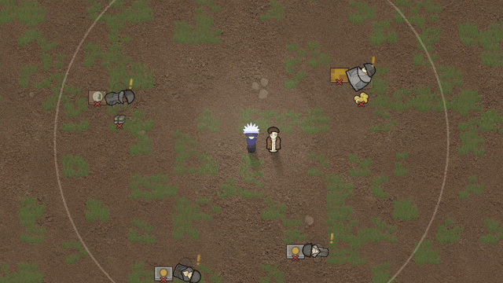

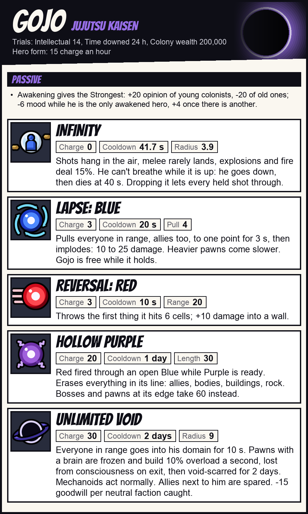

### Minato (Naruto)

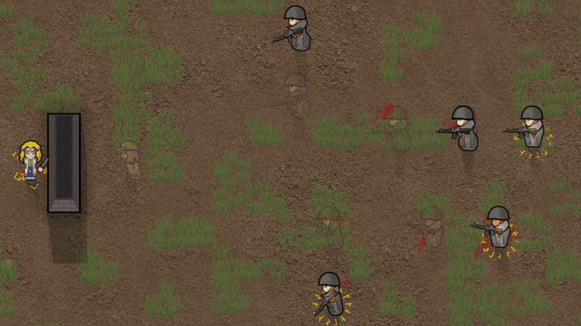

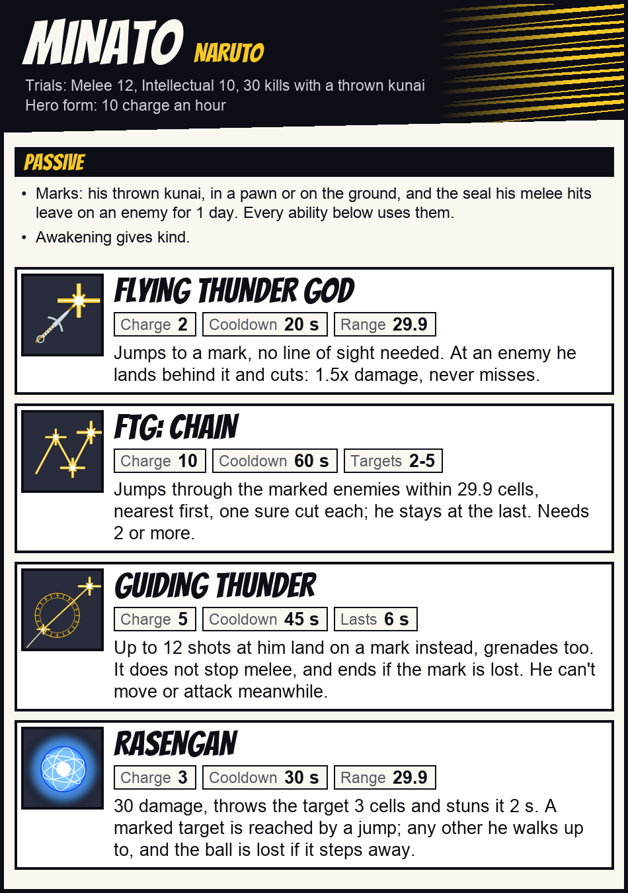

### Nakime (Demon Slayer)

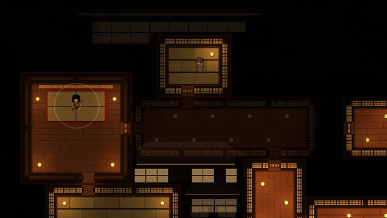

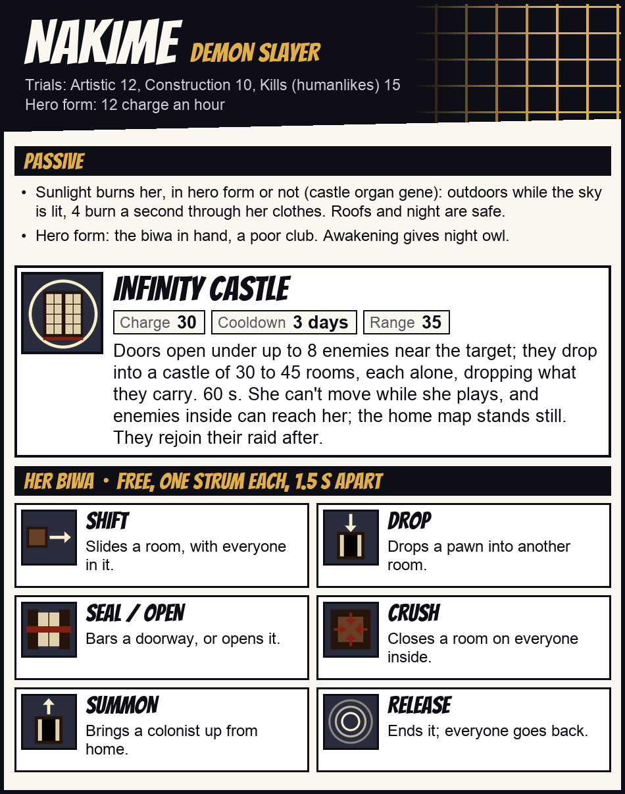

### Pain (Naruto)

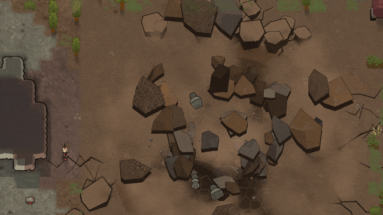

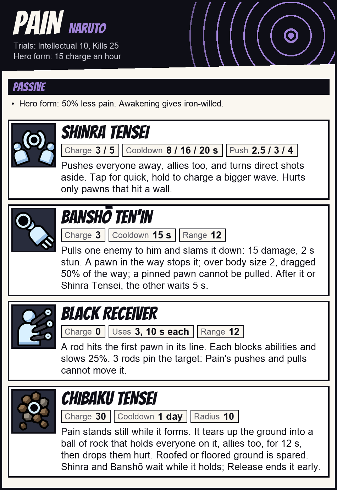

### Shirou (Fate/stay night)

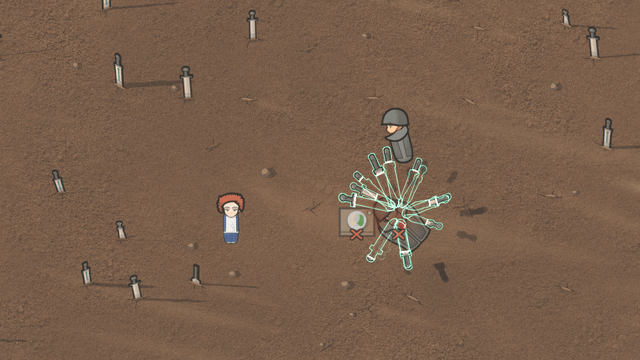

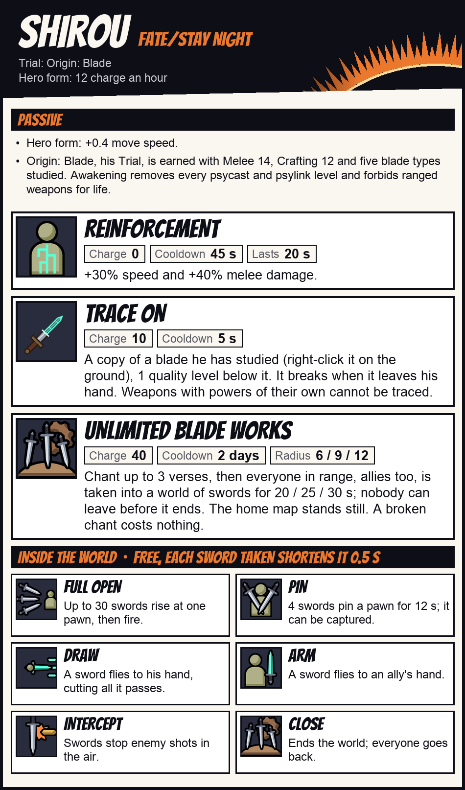

### Vergil (Devil May Cry)

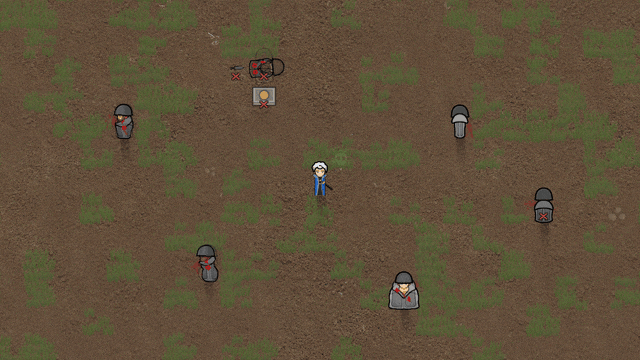

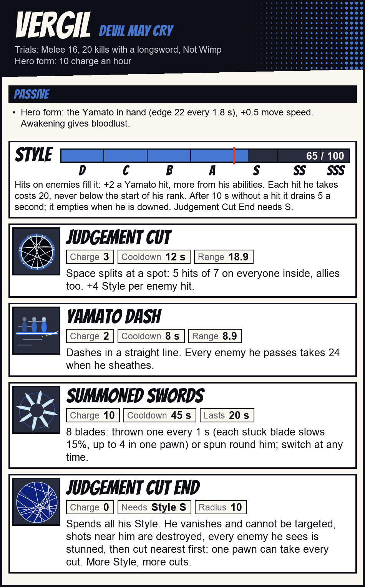

### Accelerator (A Certain Magical Index)

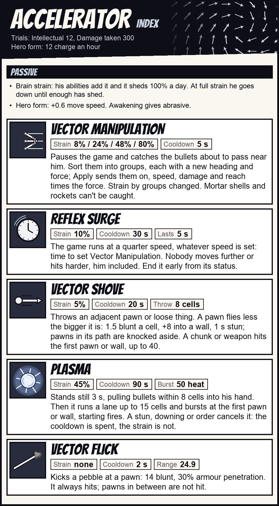

### Goku (Dragon Ball)

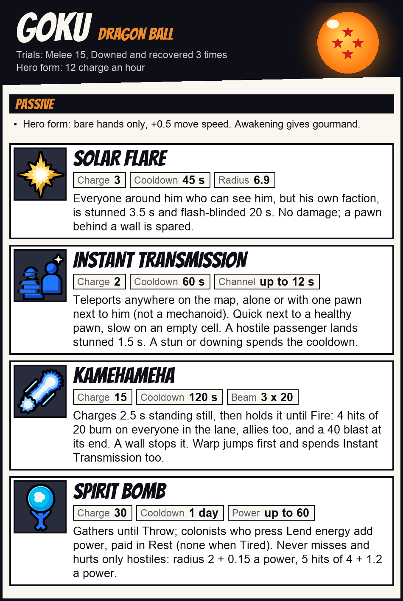

### Itachi (Naruto)

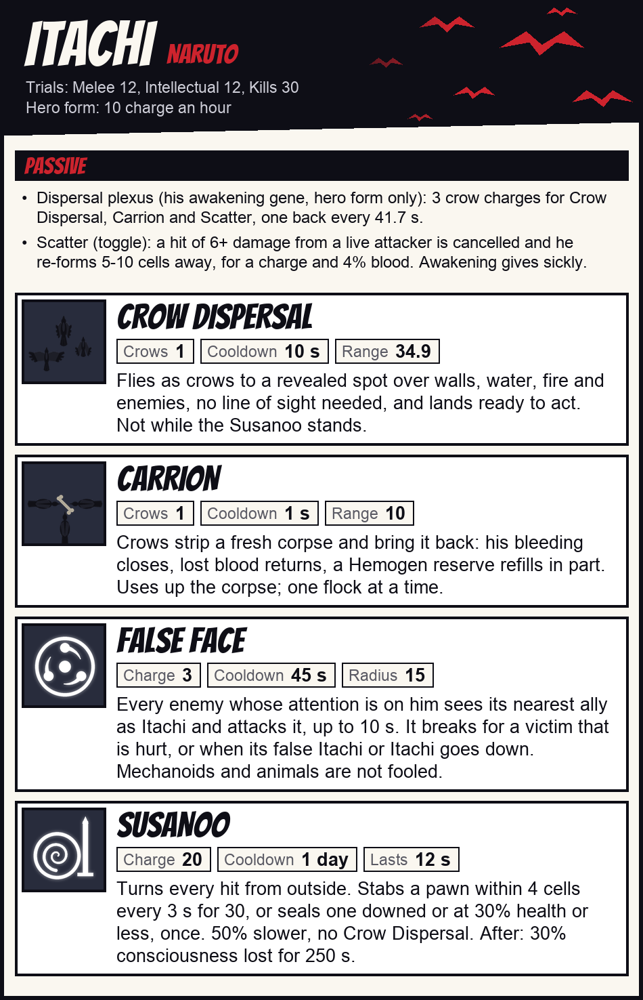

### Sasuke (Naruto)

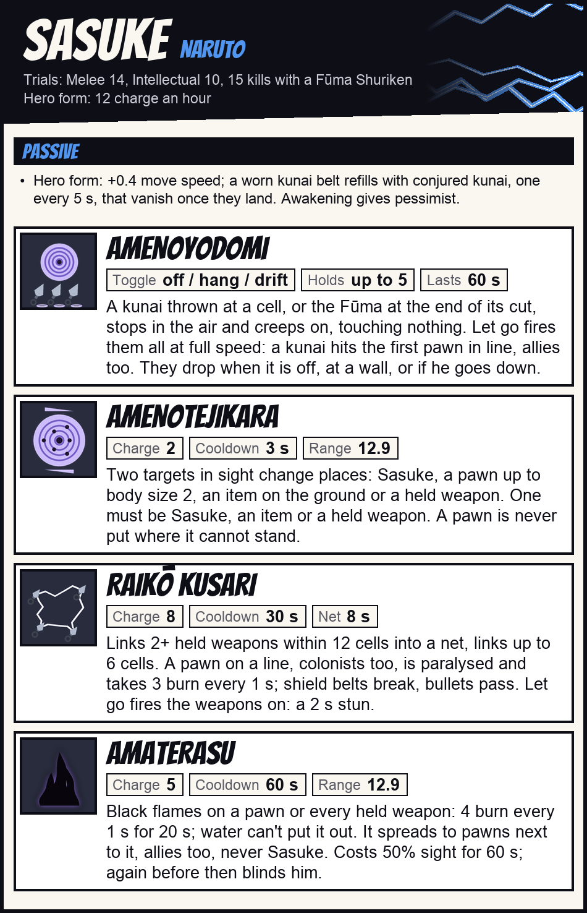

### Todo (Jujutsu Kaisen)

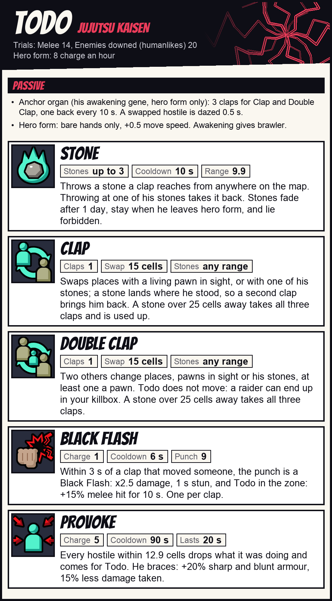

### Inumaki (Jujutsu Kaisen)

He speaks rarely, and the word is law.

**How to get it**

- To become the Host, a colonist needs Social 10 and no Psychopath trait.
- Awakening gives the Kind trait, replacing any that conflict.
- Hero form drains 8 charge an hour.

**Throat strain.** Every word strains Inumaki's throat by the percent in its line for each listener: x2 for a hostile, x2.5 for one in a mental break, x0.15 for one already obeying, less for one barely conscious. It lowers Talking by stage; at 85% there is no voice left and no word can be said. It heals 12% a day. Drinking one herbal medicine as throat syrup removes 30%. The **Volume** button on him sets how far a word carries and how much it strains: whisper 3 cells (x0.5), speak 8 cells (x1), shout 16 cells (x2).

#### Stop

Everyone who hears it stands still, then goes back to what they were doing, still holding their weapon and target.

*Casting time: 0.4 s · Cooldown: 10 s · Hold: 3 s · Throat strain: 3% per listener at speak volume*

#### Drop

Everyone who hears it and holds a weapon drops it at their feet (about half a second); they can pick it back up. Unarmed pawns do not add to the throat cost.

*Casting time: 0.4 s · Cooldown: 20 s · Throat strain: 5.5% per armed listener at speak volume*

#### Crush

Everyone who hears it is crushed and stunned.

*Casting time: 0.4 s · Cooldown: 30 s · Damage: 15 blunt, 30% armour penetration · Stun: 1 s · Throat strain: 9% per listener at speak volume*

#### Come

Everyone who hears it walks to Inumaki, then goes back to what they were doing.

*Casting time: 0.4 s · Cooldown: 30 s · Throat strain: 7% per listener at speak volume*

#### Run

Everyone who hears it runs away from Inumaki, then goes back to what they were doing.

*Casting time: 0.4 s · Cooldown: 30 s · Distance: up to 24 cells · Throat strain: 9% per listener at speak volume*

#### Explode

An explosion goes off on everyone who hears it and also hits anyone next to a listener, allies too, but not Inumaki.

*Casting time: 0.4 s · Cooldown: 1 day · Damage: 35 bomb within 1.5 cells · Throat strain: 35% per listener at speak volume*

### Obito (Naruto)

What strikes him passes into another world, and so does whoever he touches.

**How to get it**

- To become the Host, a colonist needs Melee 12 and Intellectual 10.
- Awakening gives the Sanguine trait, replacing any that conflict.
- Hero form drains 12 charge an hour.

#### Kamui: Phase

Obito becomes intangible: every hit goes through him into his Kamui dimension. While phased he cannot attack, carry or use his other abilities. Phasing spends his own pool, which refills while he is solid.

*Pool: 30 s, refills 0.25 s per second solid · Turning solid: 0.25 s*

#### Kamui: Warp

Obito winds himself into his Kamui dimension. From inside, use it again to come out at any revealed spot on the map he left; a swirl marks the spot first. Going in costs charge, coming out is free, and the cooldown starts when he comes out.

*Charge cost: 2 · Casting time: 1 s · Cooldown: 15 s · Swirl before he comes out: 0.5 s · Cooldown after coming out: 15 s*

#### Kamui: Store

Absorb: Obito touches a person or animal (or its corpse), or one item stack, and takes it into his Kamui dimension; at once if it is an enemy whose attack just went through him. Enemies inside stay stunned, allies awake. Release puts a stored thing out on a spot in sight, an enemy stunned; a weapon or heavy stack can be shot instead (Kamui: fire). An enemy not released comes back out by itself where it was taken; allies and items stay until released.

*Charge cost: 1 · Casting time: 0.4 s · Cooldown: 15 s · Largest body size: 1.2 (a megaspider) · At once on an enemy that hit him within: 5 s · Release: within 6 cells, 2 s stun, 5 s cooldown · An enemy comes back by itself after: 60 s*

#### Kamui: Fire

Shoots a stored thing out of the Kamui dimension at a target in sight, chosen from the Release menu. The Fūma Shuriken cuts everyone on its line. A melee weapon hits one target with its strongest attack. Kunai go several at a time. A stack of resources or chunks hits harder the heavier it is. Every shot but the Fūma's rolls to hit with Obito's Melee skill. People, corpses, guns, explosives, apparel and light things cannot be shot.

*Charge cost: 1 · Casting time: 0.4 s · Cooldown: 10 s · Range: 12 cells · Melee weapon: x1.3 its strongest attack · Kunai: 3 per shot · Stack of 5 kg or more: 1 blunt per kg, up to 35*

#### Fire Release: Blast Wave Wild Dance

Obito breathes a widening corkscrew of flame straight ahead. Everyone it reaches, allies too but not Obito, takes one hit, catches fire and cannot breathe for a moment (less consciousness and movement); the ground it passes burns. A wall stops it.

*Charge cost: 2 · Casting time: 0.6 s · Cooldown: 20 s · Length: 10 cells, widening to radius 2.5 · Damage: 22 burn · Breath taken: 3 s*

### Satō (Ajin)

Death is only a reset, and the war is a game he means to win.

**How to get it**

- To become the Host, a colonist needs Shooting 12, 30 kills and 500 damage taken.
- Awakening gives the Ajin and Psychopath traits, replacing any that conflict.
- Hero form drains 10 charge an hour.

#### Sever

Satō cuts off a part of his own body (a leg, an arm, a hand, a finger or an ear) and throws it; it lands as an anchor. If his body is destroyed he rises at his biggest anchor, and the Black Ghost can be summoned at any of them. An anchor past the limit makes the oldest crumble. The stump bleeds until a Reset grows the part back; with both ears cut off he is deaf.

*Casting time: 0.3 s · Cooldown: 10 s · Range: 7 cells · Anchors: up to 2, each rots after 3 days*

#### Headshot Reset

Satō shoots himself in the head, plays dead, then rises where he fell with every wound healed and every cut-off part grown back; his gear and anchors stay. Raiders take him for downed meanwhile. If the body is destroyed in that time, he rises at his biggest anchor.

*Casting time: 0.6 s · Cooldown: 60 s · Dead for: 6 s*

#### Grenade Reset

Satō pulls the pin and holds on. The blast hurts everyone around him, allies too, and destroys his body: he rises at his biggest anchor, naked (or where he stood if he has none), and his gear lies where he blew up.

*Charge cost: 5 · Casting time: 0.5 s · Cooldown: 60 s · Blast: 50 bomb within 3 cells, 30% armour penetration*

#### Black Ghost

Black matter pours out of Satō and stands up as his IBM, next to him or at one of his anchors. It fights on its own around where it formed and takes orders: go here, attack, and once per summon tear an arm or a leg off an enemy next to it. It takes half damage, lasts longer the bigger the piece it formed at, and dissolves when he reverts.

*Charge cost: 10 · Casting time: 0.5 s · Cooldown: 120 s · Range: 31 cells · Guards within: 9 cells · Lasts: 45 / 45 / 35 / 20 / 10 / 10 s at Body / Leg / Arm / Hand / Finger / Ear*

#### The Game

Satō marks the next player to lose. The marked enemy takes more damage from his shots; if it dies while marked, to anyone, the pool gets charge back. One mark at a time.

*Charge cost: 5 · Casting time: 0.3 s · Cooldown: 45 s · Range: 30 cells · Mark: 30 s, x1.3 damage from his shots · Kill refund: 15 charge*

### Shikamaru (Naruto)

Where his shadow reaches, nothing moves but by his leave.

**How to get it**

- To become the Host, a colonist needs Intellectual 14 and 5 people captured.
- Awakening gives the Industrious trait, replacing any that conflict.
- Hero form drains 10 charge an hour.

#### Shadow Imitation

The shadow runs over the ground to one person, animal or mech and holds it: it cannot act, and every cell Shikamaru steps drags it one cell the same way. A body over size 2 is held half as long. Reach scales with the light where he stands: half in daylight, full by a lamp or fire, none in the dark. The line breaks when a pawn crosses it, a cell under it goes dark, or smoke covers it.

*Charge cost: 3 · Casting time: 1 s · Cooldown: 20 s · Reach: 20 cells x light · Hold: 15 s*

#### Shadow Seam

Sews two pawns or loose items that stand in light together: they cannot get far apart, whoever moves drags the other, and when both pull the larger body wins (an item never does). Reach scales with the light where he stands. It breaks like every shadow line: a pawn crossing it, a dark cell under it, smoke over it.

*Charge cost: 3 · Casting time: 0.8 s · Cooldown: 30 s · Reach: 16 cells x light · Seam: 20 s, at most 4 cells apart*

#### Shadow Grasp

A hand of shadow slides a loose item, a weapon on the ground, a corpse or a downed body over the ground to a chosen cell; it is not teleported. A pawn on the path stops it in that pawn's cell; a wall or another item stops it before. Both the thing and the cell must be within reach, which scales with the light where he stands. A grenade in the air cannot be picked.

*Charge cost: 1 · Casting time: 0.5 s · Cooldown: 15 s · Reach: 25 cells x light · Speed: 12 cells per second (item), 6 (body)*

#### Shadow Double

His shadow goes to a lit cell and stands there. While it stands, shadow imitation, seam and grasp are cast from its cell and use its light, so he can stay in the dark. It copies his steps; a wall stops it. It is not a pawn and cannot be hit. It ends early when its cell goes dark or a pawn crosses the line between it and him (that line may cross dark cells).

*Charge cost: 5 · Casting time: 1 s · Cooldown: 60 s · Reach: 25 cells · Stands: 20 s*

#### Shadow Neck Bind

Only on a pawn held by shadow imitation or sewn by shadow seam: hands of shadow climb the line and close on its throat while he channels, standing still. At full suffocation it falls unconscious for 2 minutes, not dead. If the line breaks, he moves or gets another order, the hands fall off and the suffocation drains. Mechanoids have no throat.

*Charge cost: 2 · Cooldown: 45 s · Climb: 1.5 s · Channel: up to 8 s, suffocation +12.5% per second*

#### Shadow Spread

The shadow splits and holds several enemies near a chosen cell, nearest it first: they cannot act, and every cell Shikamaru steps drags each the same way. A body over size 2 is held half as long. Each pawn has its own line, cut as usual and freeing only its pawn; reach to each scales with the light where he stands. Pawns are chosen when it fires, so one that walks out during the cast is not caught. It and shadow imitation replace each other's holds.

*Charge cost: 20 · Casting time: 1.5 s · Cooldown: 120 s · Reach: 20 cells x light · Targets: up to 5 within 5 cells of the cell · Hold: 12 s*

#### Shadow Gathering

Shikamaru gathers the shadows around him into his own for 20 seconds: his lines are cut only by a body of size 2 or more, go dark only under 15% light instead of 30%, and need smoke twice as thick to be covered. Reach does not change, and a line still breaks if he goes down. It needs shade around where he casts from (him or a standing shadow double): a roof, walls or dim light; open ground in daylight has none.

*Charge cost: 3 · Casting time: 0.5 s · Cooldown: 45 s · Needs: 8 cells under 40% light within 4 cells*

## Weapons and gear

**One of a kind:** the four E.G.O. weapons, Last Prism, Samehada and Power Pole are made at the fabrication bench after their research, and only one of each can ever exist in a world, even after it is destroyed.

A weapon gives its abilities while equipped and a worn item while worn; they go away when it is removed, and a weapon keeps its cooldowns when it changes hands.

### Weapons

#### Chain Sickle

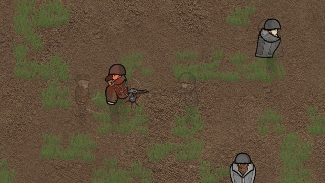

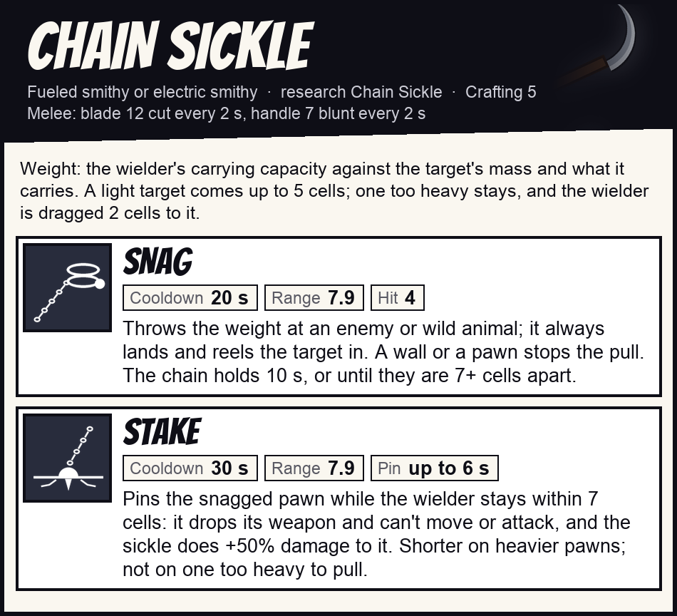

#### Flame Gauntlet

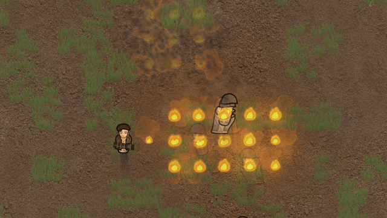

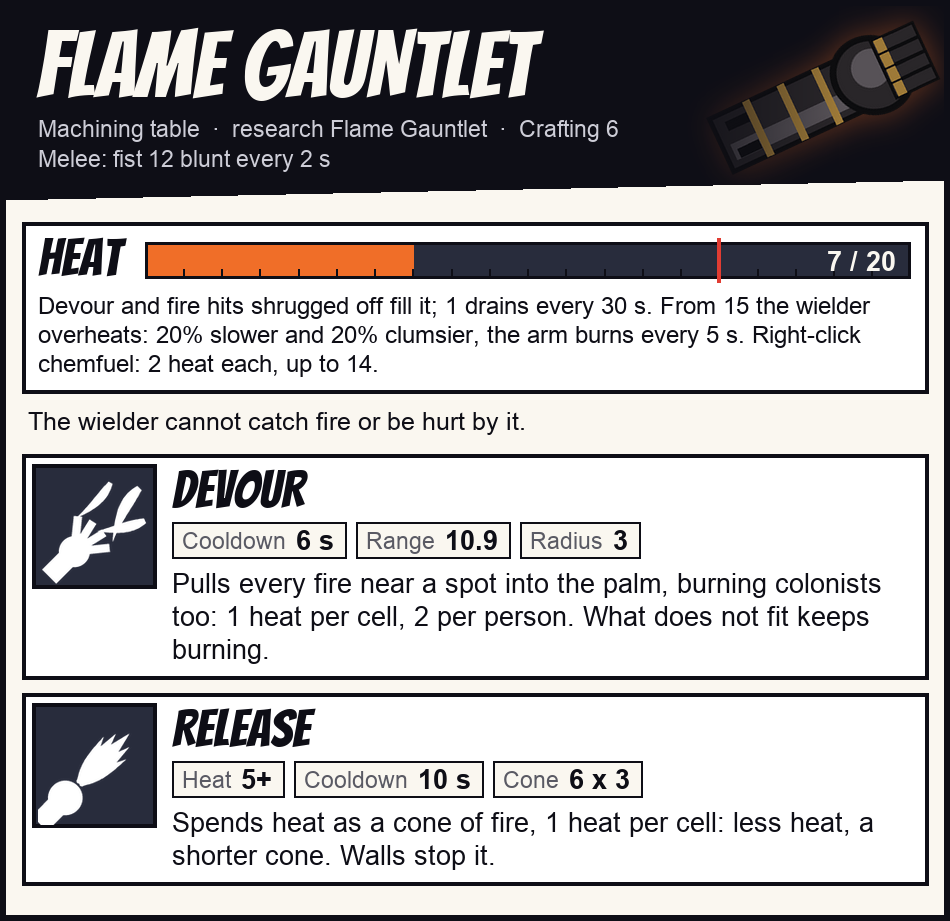

#### Last Prism (Terraria)

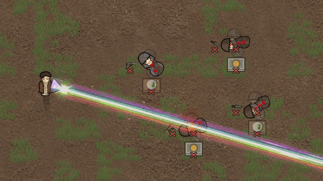

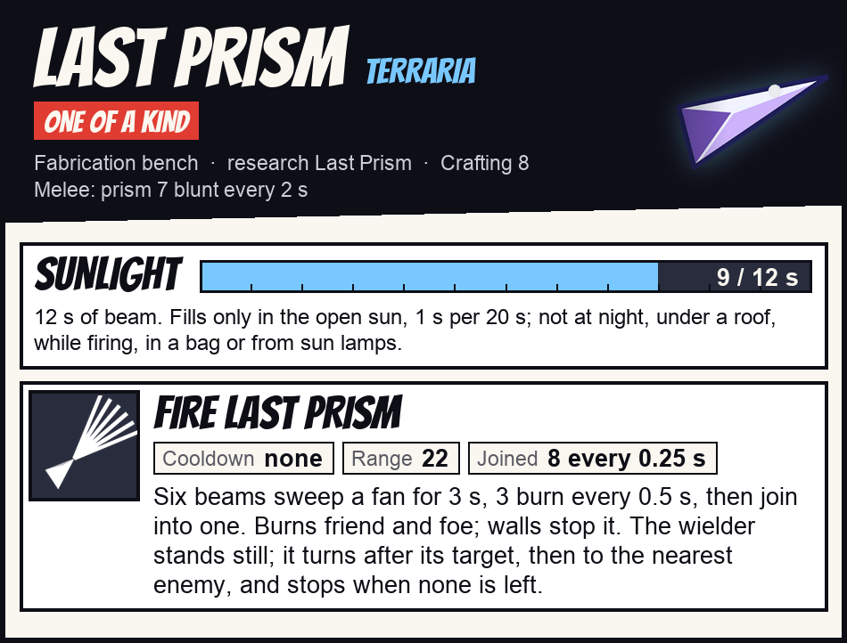

#### Power Pole (Dragon Ball)

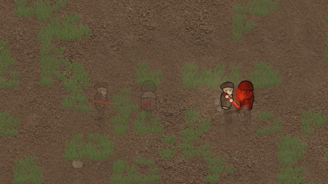

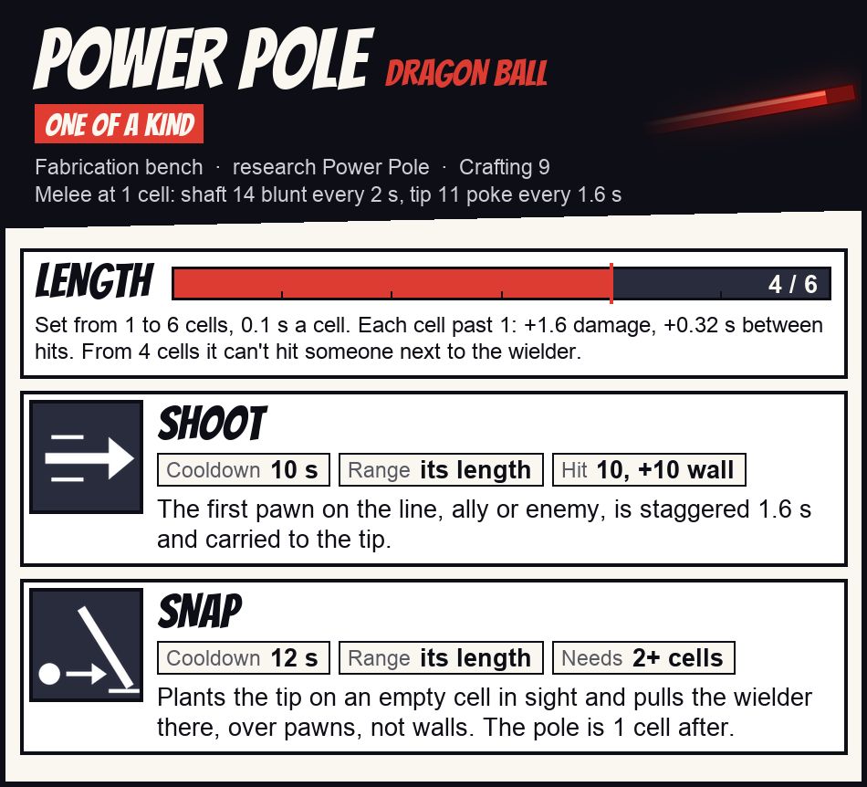

#### Samehada (Naruto)

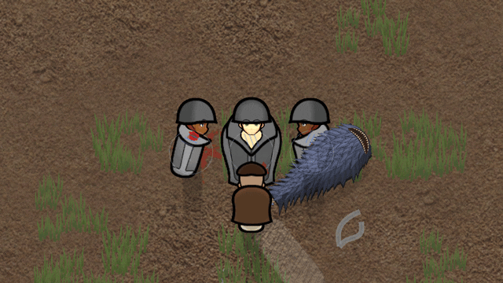

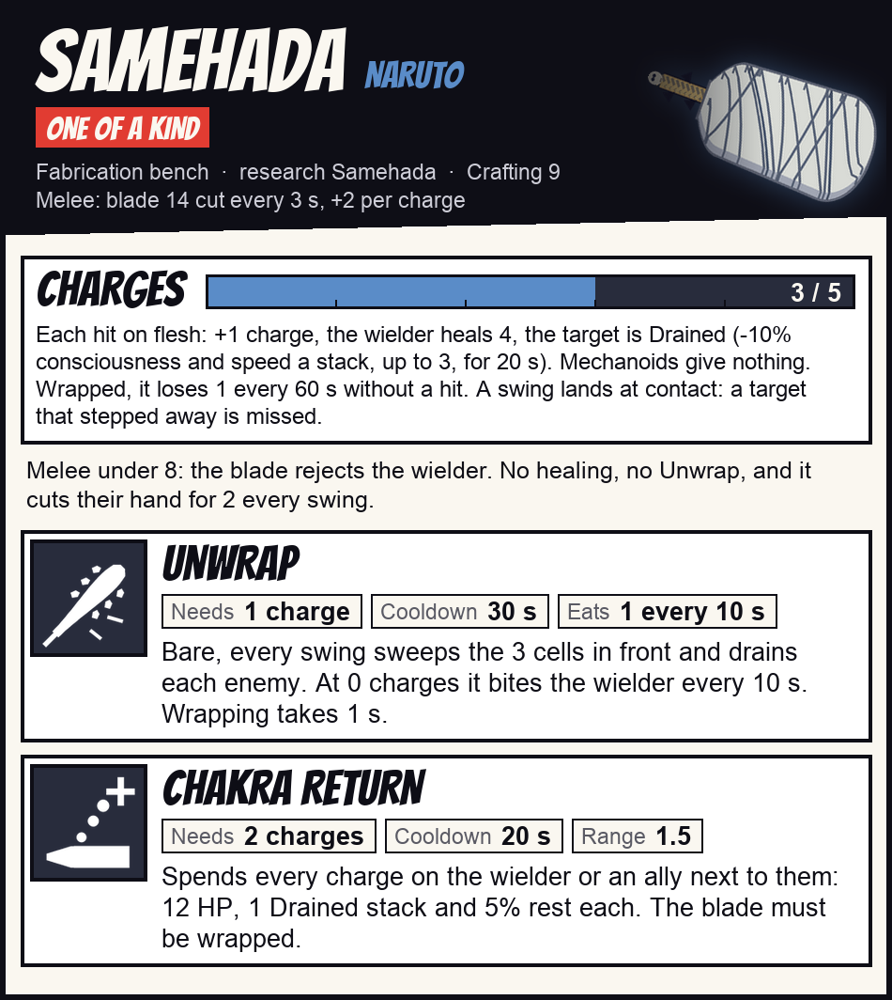

#### Bank Shot Pistol

A heavy pistol whose bullets bounce off walls. Normal fire works like a revolver, and a missed bullet that hits a wall bounces once and can still hit someone. The wielder can also use Bank Shot.

**How to get it**

- Craft it at a machining table after researching **ricochet rounds** (which needs gunsmithing). Needs Crafting 5. Costs 40 steel and 3 components.
- Can be bought from traders.

##### Bank Shot

Charges the pistol, then fires toward a spot, usually a wall. The bullet bounces off walls and closed doors and embeds in the wall after its last bounce. It stops at the first standing pawn it crosses, ally or enemy, needs no line of sight to it, and hits harder for every bounce before the hit. The whole path is drawn while aiming.

*Casting time: 1.5 s · Cooldown: 4 s · Bounces: up to 3 · Damage: 18 + 6 per bounce · Flight: 30 cells, bounces included*

#### Bubble Pipe

A bamboo blowpipe and a jar of soap solution worn at the hip. The jar holds 10 blows and refills 1 blow a second while the wielder stands on or next to water. The wielder can use Drifting Burst and Eye Pop. In melee it is a weak blunt poke.

**How to get it**

- Craft it at a crafting spot or machining table after researching **bubble pipe**. Needs Crafting 3. Costs 15 wood and 5 cloth.

##### Drifting Burst

Blows a fan of soap bubbles that drift slowly toward a spot. The first pawn other than the wielder to touch one pops it, and the burst hurts and staggers every pawn close by, allies too. Bubbles that touch a wall or drift too long pop harmlessly.

*Casting time: 0.45 s · Cooldown: 10 s · Bubbles: 6, drifting up to 8 s · Burst: 5 blunt within 0.8 cells, 1 s stagger · Soap: 2 blows*

##### Eye Pop

Blows one bubble at a pawn's face; it always gets there and leaves soap in its eyes: shooting accuracy -30%, melee hit chance halved, move speed -30%. No damage.

*Casting time: 0.45 s · Cooldown: 8 s · Range: 9 cells · Soap in the eyes: 5 s · Soap: 1 blow*

#### Coil Gun

A rifle that throws its rounds with magnetic coils, fed from a battery in the stock. Normal fire uses no charge, and mechanoids take 1.5 times its damage. The wielder can use Chain Arc, which spends charge from the gun's 20. The battery does not refill on its own: within 1.5 cells of a charged battery it recharges 1 a second, taking 10 Wd for each.

**How to get it**

- Craft it at a machining table after researching **coil gun** (which needs microelectronics). Needs Crafting 6. Costs 60 steel, 20 plasteel and 4 components.
- Can be bought from traders.

##### Chain Arc

Fires a bolt of lightning at a hostile pawn that jumps on to the nearest hostile near the last one hit, skipping allies and downed pawns. Mechanoids and soaked pawns take more, and from a soaked pawn the next jump reaches further.

*Casting time: 0.5 s · Cooldown: 20 s · Range: 26 cells · Jumps: 3, each within 3 cells (x2 from a soaked pawn) · Damage: 12 electrical burn, 35% armour penetration · Mechanoids x1.5, soaked x1.5 · Battery: 5*

#### Frost Bomb

A cryogenic charge in a throwable tube. It bursts into a small freezing cloud: everyone in it, your own people too, stops moving and cannot fight for a few seconds, then thaws; frozen targets can still be shot. The tube rebuilds its charge between throws and is never used up.

**How to get it**

- Craft it at a machining table after researching **cryogenic munitions** (which needs machining). Needs Crafting 5. Costs 20 steel, 2 components and 40 chemfuel.
- Can be bought from traders.
- Equip it as a weapon; the throw is a button on the pawn.

##### Throw Frost Bomb

Cooldown: 6 s · Range: 13 cells

#### Frost Rifle

A rifle that fires bolts of supercooled gas. Each hit chills a creature, 10% slower per stack up to 3, for 10 seconds; normal fire uses no coolant. The wielder can use Flash Freeze. The 30-unit coolant tank refills 0.1 a second while held, and 2 a second below 0 °C.

**How to get it**

- Craft it at a machining table after researching **frost rifle** (which needs cryogenic munitions). Needs Crafting 6. Costs 70 steel and 5 components.
- Can be bought from traders.

##### Flash Freeze

Fires a freezing beam at one creature that is soaked or chilled 3 times; it is frozen solid and cannot move or act. The next hit shatters the ice for extra damage; otherwise it thaws. Uses up the soaking or the chill.

*Casting time: 0.8 s · Cooldown: 30 s · Range: 23 cells · Frozen: 5 s · Shatter: 15 cut · Coolant: 10*

#### Fūma Shuriken

A massive folding shuriken. Use it in melee, or throw it at a cell: it cuts every pawn in its path, allies too, for 30 cut, 20% less for each pawn after, at least 8; walls and closed doors stop it. Throwing leaves you unarmed; the same weapon lands intact to be picked up again, and a retrieval hook can pull it closer.

**How to get it**

- Craft it at an electric smithy or fueled smithy after researching **smithing**. Needs Crafting 6. Costs 80 steel.
- Can be bought from traders.
- Equip it as a melee weapon; the throw is a button on the pawn.

##### Throw Fūma Shuriken

Cooldown: 4 s · Range: 12 cells

#### Mimic Beacon

A throwable projector that stands a copy of the thrower where it lands. The copy cannot move or fight, but most enemies shoot at it. It stops nothing: it fails when shot to pieces or after about 20 seconds. It rebuilds its charge between throws and is never used up.

**How to get it**

- Craft it at a machining table after researching **holographic projection** (which needs machining and microelectronics). Needs Crafting 6. Costs 40 steel, 4 components and 10 gold.
- Can be bought from traders.
- Equip it as a weapon; the throw is a button on the pawn.

##### Throw Mimic Beacon

Cooldown: 8 s · Range: 13 cells

#### Tag Scroll

A roll of up to 20 explosive tags on a wooden rod. The wielder can use Tag Throw, Tag Line and Paper Shroud, and Detonate while a tag line is laid; every burst hurts allies too. The toggle on the wielder sets whether a laid tag line waits for Detonate or goes off when a hostile steps on it. Reload with explosive tags: the wielder reloads on their own when it is empty, or right-click tags to reload early; a new scroll comes with 20. In melee the rod is a weak blunt weapon.

**How to get it**

- Craft it at a machining table or crafting spot after researching **explosive tags** (which needs machining). Needs Crafting 5. Costs 20 wood and 30 cloth.

##### Tag Throw

Throws one tag on a steel pin at a cell, pawn or wall; it sticks, burns briefly, then bursts, allies included. Stuck in a pawn it goes where the pawn goes; stuck in a wall or solid building, that building takes several times the damage. It rolls to hit with Melee like a thrown kunai, and a miss still sticks near the target.

*Casting time: 0.3 s · Cooldown: 4 s · Range: 13 cells · Fuse: 2 s · Burst: 35 bomb within 1.5 cells, x4 to a building it sticks in · Tags: 1*

##### Tag Line

Flicks the scroll's strip along the ground (2.5 seconds standing still): plain strip first, then one tag per cell, each using a tag; a wall stops it short. The line lasts a day. Detonate lights it from the caster's end, or with the tripwire toggle on, the first hostile to step on a tag lights it there; the fuse runs along it and each tag bursts, allies included.

*Casting time: 0.3 s · Cooldown: 20 s · Range: 11 cells · Tags: up to 8 · Each tag: 30 bomb within 1.1 cells, 0.1 s apart*

##### Paper Shroud

Sends tags at one pawn; they stick all over it, stun it, then all go off: heavy damage to the target and less to everything next to it, allies included.

*Casting time: 0.35 s · Cooldown: 45 s · Range: 7 cells · Tags: 6 · Stun: 2 s · Burst: 60 bomb to the target, 20 within 0.9 cells*

##### Detonate Tag Line

Makes a hand seal and lights every tag line this pawn has laid, from the caster's end of each, at any distance and without line of sight. Uses no tags.

*Casting time: 0.35 s · Cooldown: 1 s*

#### Vacuum

The wand and floor head of a conjured vacuum cleaner. In melee the wand is a blunt club. The wielder can use Suck, Spit and Digest. The mouth holds only the last thing swallowed; anything older is in the stomach for good. It holds 100 kg, and the wielder is 0.4% slower per kg inside.

**How to get it**

- Craft it at a machining table after researching **vacuum** (which needs machining). Needs Crafting 5. Costs 60 steel, 15 cloth and 2 components.

##### Suck

Pulls every loose item and all filth near a spot into the head, lightest first, so the heaviest ends up in the mouth; the nearest hostile there loses the weapon in its hands too (allies and neutrals keep theirs). Anything that would go over 100 kg stays. Cannot be used when full. Shares its cooldown with Spit.

*Casting time: 0.3 s · Range: 13 cells · Radius: 2 cells*

##### Spit

Fires the thing in the mouth at a pawn or cell: a pawn there takes damage by its weight and is dazed, and the thing lands as itself. The stomach keeps the rest. Shares its cooldown with Suck.

*Casting time: 0.3 s · Range: 13 cells · Damage: 1.5 blunt per kg, up to 40 · Daze: 1.2 s*

##### Digest

The wielder stands still while the vacuum chews everything inside, mouth first; all of it is destroyed. Stopped early, the rest stays inside.

*Casting time: 0.3 s · Time: 0.05 s per kg, at least 0.5 s*

#### Water Gun

A pump-action water gun fed by a hose from a 30-unit water bag on the back. The wielder can use Stream Shot and Hydro Pump. A soaked pawn is 10% slower, feels the cold sooner and cannot catch fire. The bag refills 10 units a second on or next to water, and 1 every 5 seconds outdoors in rain. In melee the gun is a weak blunt weapon.

**How to get it**

- Craft it at a machining table after researching **water gun** (which needs machining). Needs Crafting 5. Costs 40 steel, 20 cloth and 1 component.

##### Stream Shot

Fires a jet of water at a pawn or cell; it always lands. A pawn is hurt and soaked, and fire on the pawn and the cell is put out.

*Casting time: 0.25 s · Range: 21 cells · Damage: 6 blunt · Soaked: 60 s · Water: 1*

##### Hydro Pump

Blasts a cone of water: every pawn in it the wielder can see, allies too, is hurt, pushed away, knocked down and soaked, and fire in it is put out.

*Casting time: 0.6 s · Cooldown: 12 s · Cone: 5 cells long, 3 wide · Hit: 8 blunt, 3-cell push, 2 s knockdown · Soaked: 60 s · Water: 10*

### E.G.O. weapons

#### Paradise Lost (Lobotomy Corporation)

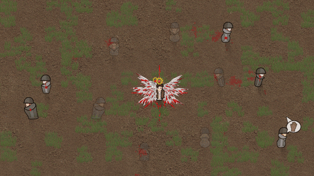

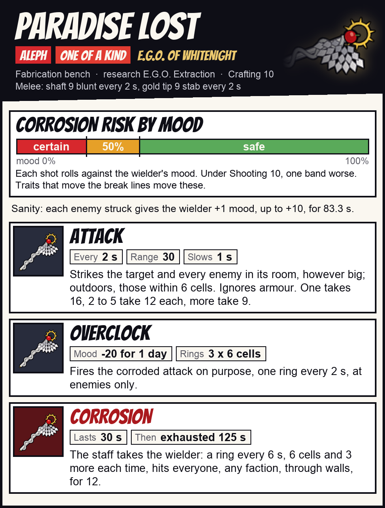

#### Magic Bullet

A long black rifle with a gold band round the chamber: E.G.O. gear from Der Freischütz.

**How to get it**

- Craft it at a fabrication bench after researching **E.G.O. extraction** (which needs pulse-charged munitions). Needs Crafting 10. Costs 100 plasteel, 50 gold and 4 advanced components.
- One of a kind: once one has existed in this world, no other can be made, even after it is destroyed, sold or lost. Traders never sell it and it is never a reward or loot.
- A manifested hero cannot equip it. Held when a hero manifests, it waits in the inventory and is equipped again when the hero reverts.
- Equip it as a ranged weapon; it attacks like any gun. A colonist holding it also gets the Overclock button.

##### Attack

Each shot is a straight line that goes through walls and cover, never misses, and hits every pawn on it for 18, allies and the downed too, and a building it is aimed at. The seventh shot cannot be aimed: it goes to the pawn the shooter likes most (else a bonded animal, else the shooter), hitting everyone between for 30, and the gun then rests 20 seconds. The count stays with the gun; on the sixth shot the counter names the seventh's target.

##### Corrosion

Every shot may let the gun take its wielder: 25% below the minor break threshold, 75% below the major, certain below the extreme, one step worse under Shooting 6, never above the minor. For 30 seconds the wielder ignores orders while the gun fires at the nearest pawn of any faction every 3 seconds (these count toward the seventh), then is exhausted for 2 hours.

##### Overclock

The wielder fires 6 lines, one a second, at the nearest hostile within 40 cells; only hostiles are hit and the count does not move. Costs 15 mood for 1 day.

#### Mimicry

A greatsword of red muscle and bone: E.G.O. gear from Nothing There.

**How to get it**

- Craft it at a fabrication bench after researching **E.G.O. extraction** (which needs pulse-charged munitions). Needs Crafting 10. Costs 100 plasteel, 50 gold and 4 advanced components.
- One of a kind: once one has existed in this world, no other can be made, even after it is destroyed, sold or lost. Traders never sell it and it is never a reward or loot.
- A manifested hero cannot equip it. Held when a hero manifests, it waits in the inventory and is equipped again when the hero reverts.
- Equip it as a melee weapon; it attacks like any blade. A colonist holding it also gets the Overclock button.

##### Attack

Each hit on a living creature heals the wielder 10% of the damage (not scars or lost limbs). A swing has a 10% chance to slam a 2.7-cell strip for 3.5x damage on every standing hostile in it; the slam cannot miss or be dodged, armour still counts, and walls block it.

##### Corrosion

Each swing may let the sword take its wielder: 50% below the minor break threshold, certain below the major, one step worse under Melee 8, never above the minor. For 40 seconds the wielder ignores orders and attacks the nearest pawn it can reach, any faction, downed too, lunging up to 2 cells. Each hit it deals grows the arm (+15% damage, up to 4 stages); each hit it takes shrinks it. Then it is exhausted for 3 hours.

##### Overclock

5 swings, one a second, at standing hostiles next to the wielder, who stands still. Costs 20 mood for 1 day.

#### Solemn Lament

A pair of pistols, one white and one black: E.G.O. gear from the Funeral of the Dead Butterflies. They take turns, white first.

**How to get it**

- Craft it at a fabrication bench after researching **E.G.O. extraction** (which needs pulse-charged munitions). Needs Crafting 10. Costs 100 plasteel, 50 gold and 4 advanced components.
- One of a kind: once one has existed in this world, no other can be made, even after it is destroyed, sold or lost. Traders never sell it and it is never a reward or loot.
- A manifested hero cannot equip it. Held when a hero manifests, it waits in the inventory and is equipped again when the hero reverts.
- Equip it as a ranged weapon; it attacks like any gun. A colonist holding it also gets the Overclock button.

##### Attack

Each pull fires 4 shots that always hit. A white shot does no harm and puts 2 Butterfly stacks on the target; a black shot does 9 damage and puts on 1. The pair holds 20 shots and reloads for 3 seconds when empty.

##### Butterfly

Each stack takes 7.5% consciousness, so an unhurt pawn goes down at 10 stacks, the cap; one fades every 10 seconds.

##### Corrosion

Every shot may let the guns take their wielder: 25% below the minor break threshold, 75% below the major, certain below the extreme, one step worse under Shooting 4, never above the minor. For 30 seconds the wielder ignores orders and walks to stand beside the nearest person or animal of any faction; every second each pawn within 3 cells takes a stack past the cap, and a downed pawn within 3 cells dies at 20 stacks. Then the wielder is exhausted for 2 hours.

##### Overclock

For 5 seconds, each second every standing hostile within 3 cells takes a stack, never past the cap. Costs 15 mood for 1 day.

### Worn

#### Drone Control Rig

A belt-mounted transmitter and handset for a demolition drone. The wearer builds and deploys one toy car at a time and drives it; the driver cannot move, shoot or work, and the car blows up on command or if the driver goes down.

**How to get it**

- Craft it at a machining table after researching **remote ordnance** (which needs machining and microelectronics). Needs Crafting 6. Costs 40 steel and 3 components.
- Can be bought from traders.

##### Deploy Toy Car

Assembles a remote demolition drone just in front of the wearer. It does nothing until someone drives it, and the driver cannot move, shoot or work meanwhile. It blows up on command, or by itself if the driver is downed or killed while driving.

*Casting time: 0.8 s · Cooldown: 250 s*

#### Kunai Belt

A belt with loops for 6 kunai, thrown with throw kunai. Reload it with kunai: the wearer reloads on their own when it is empty, or right-click kunai to reload early. A new belt comes with 6.

**How to get it**

- Craft it at a fueled smithy or electric smithy after researching **smithing**. Needs Crafting 4. Costs 30 steel and 20 cloth.
- Holds 6 charges and starts full. Reload with kunai (1 per charge). Make 5 from 25 steel at a fueled smithy or electric smithy after researching **smithing**.

##### Throw Kunai

Throws one kunai from the kunai belt: 12 stab, 18% armour penetration. It rolls to hit with the thrower's Melee skill, counting distance, cover and weather like a gun, and a miss can hit someone near the line. A hit breaks it 20% of the time; otherwise it sticks in the body part (up to 3 per target) and that wound bleeds at half rate. Right-click the target to pull them out: 2 seconds for all, or from a standing enemy a melee roll per kunai; each comes back and cuts the wound again. Misses, and kunai in a killed target, drop to be picked up.

*Casting time: 0.3 s · Cooldown: 1.5 s · Range: 15 cells*

#### Makibishi Pouch

A cloth pouch of 3 handfuls of makibishi, scattered with scatter makibishi. Reload it with makibishi: the wearer reloads on their own when it is empty, or right-click makibishi to reload early. A new pouch comes with 3.

**How to get it**

- Craft it at a hand tailor bench or electric tailor bench. Needs Crafting 3. Costs 30 cloth.
- Holds 3 charges and starts full. Reload with makibishi (1 per charge). Make 5 from 10 steel at a fueled smithy or electric smithy after researching **smithing**.

##### Scatter Makibishi

Tosses a handful of makibishi onto a 3x3 patch for 30 seconds: the centre and the 4 cells beside it always, each corner half the time, never on water or behind a wall. Each step onto a spiked cell has a 35% chance to hit a foot: 4 stab and a limp (-30% movement) that fades over 15 seconds. Colonists and allies are hurt the same, though people walk around spikes when the way round is short. Flyers and mechanoids are not affected.

*Casting time: 0.5 s · Cooldown: 2 s · Range: 10 cells*

#### Retrieval Hook Belt

A belt-mounted launcher that fires a padded net on a tether and reels in a downed colonist, slave or ally, or part of an item stack.

**How to get it**

- Craft it at a machining table after researching **machining** (which needs electricity and smithing). Needs Crafting 5. Costs 60 steel, 2 components and 20 cloth.

##### Retrieval Hook

Fires a padded net on a tether and reels the target in: a downed colonist, slave or ally, or an item (weapons, apparel, medicine, food, resources, minified buildings), up to 20 kg of a stack. The wearer stands still until it arrives; moving, going down or taking the belt off stops it. After every shot, hit or miss, the tether must be reeled in (10 seconds standing still). Dragging an injured person worsens one wound and removes its bandage, but cannot kill them or destroy the part.

*Casting time: 0.5 s · Range: 15 cells*

#### Sleeper Box

A wooden box worn on the back that holds one pawn of body size 1 or less: a colonist, slave, colony animal or any downed pawn. The wearer is 15% slower per body size inside.

Inside, the pawn sleeps and cannot be hurt: bleeding stops, hunger and recreation pause, and cold, heat and sunlight do not reach it, while rest, healing and diseases go on. It comes out after 12 hours, within 1 hour of being fully rested, or when the wearer dies or the box comes off, and cannot go back into a box for 2 hours.

Come out: a colony pawn that is not downed leaps to a cell within 4 cells; an enemy next to where it lands takes one melee hit that cannot miss and is stunned 1.5 seconds. Others are let out beside the box.

**How to get it**

- Craft it at a crafting spot after researching **sleeper box** (which needs complex furniture). Needs Crafting 4. Costs 60 wood, 15 steel and 10 cloth.

##### Go In

The wearer walks to a pawn and puts it into the box: a colonist, slave, colony animal or any downed pawn of body size 1 or less. Not mechanoids, not a pawn in a mental break unless it is downed, and not one that came out of a box in the last 2 hours.

*Casting time: 0.25 s · Range: 30 cells*

#### Stasis Belt

A field generator worn at the waist. Triggered, it stops time in a sphere around the wearer: nothing inside moves, burns, bleeds or can be harmed, the wearer included. It takes days to wind back up, and the cooldown stays with the belt when it changes hands.

**How to get it**

- Craft it at a machining table after researching **stasis fields** (which needs shields). Needs Crafting 8. Costs 2 advanced components, 60 plasteel and 20 gold.
- Can be given as a quest reward.

##### Stasis Field

Stops time in a sphere around the wearer: nothing inside moves, burns, bleeds or can be harmed, raiders, your own people and the wearer alike. It buys time for everyone outside it.

*Casting time: 1 s · Cooldown: 5 days · Radius: 7 cells · Duration: 20 s*

## Compatibility

- **1.7 (unstable beta):** It loads, but I haven't fully tested it yet. Some effects may look off on the new engine (known: the stasis field's dome draws black). The abilities themselves work the same. I'll add full support once 1.7 is stable. If you try it on the beta, let me know how it goes.
- **Saves:** Safe to add to an existing save. Back up your save first, as with any big mod. Don't remove it from a save: heroes, items and pocket maps are saved with the colony.
- **Melee Animation** (optional): I recommend using this. It adds animations to some abilities and weapons. Without it, everything still works, just without those animations.
- **Combat Extended:** Not tested yet. A few weapons have CE patches; heroes are not balanced for CE.
- **VPE:** Should work, since heroes don't use psycasts, and effects that block psycasts (Pain's chakra rods, Shirou's Trial) block VPE psycasts too.
- **HAR:** Not tested yet, but it should work. The costume is drawn over the colonist's own body instead of being worn, so race clothing limits shouldn't block it. It's built for vanilla body types, so some races may look a little off. Feel free to report anything weird.

## FAQ

**How do I get a hero?** On day 10 a meteorite brings the resonance shard. Study it at a research bench, research the resonance device, build it, pick a hero and a colonist in its tab, pass the Trials, Awaken. The day can be changed in the mod settings (0: at once).

**Two of the same hero?** No. Each hero has one Host per colony.

**A second Paradise Lost?** No. One-of-a-kind weapons are made once per world.

**Can enemies use heroes or these weapons?** Not yet. Some abilities have complex mechanics or are designed specifically for player use, and programming raiders to use them requires a lot of testing. For the first version of this mod, heroes and weapon abilities are strictly for the player. However, I might allow raiders to use these powers in later updates.

**Why do only some heroes change clothes?** I haven't finished making costumes for all the heroes yet, but costumes are purely cosmetic and do not affect gameplay stats. More will be added in future updates.

**[X] hero or weapon feels too weak/OP!** Some probably are. It's a big crossover, but I don't want it to trivialize the game: the aim is VPE-level power, and at worst nothing should be stronger than VPE's most broken paths. Expect buffs and nerfs in updates. I also plan to add settings so you can tune each hero and weapon yourself. If something feels off, tell me which one and why.

## Known issues

- With Melee Animation, a pawn frozen by the stasis belt can still be executed.

## Bug reports

Something broke? Please tell me in the pinned **Bug reports** thread. If you can, add your log, your mod list and what happened.

## Credits

Fan work, free and unofficial. All characters, weapons and names belong to their original creators. Not affiliated with them or with Ludeon Studios.
